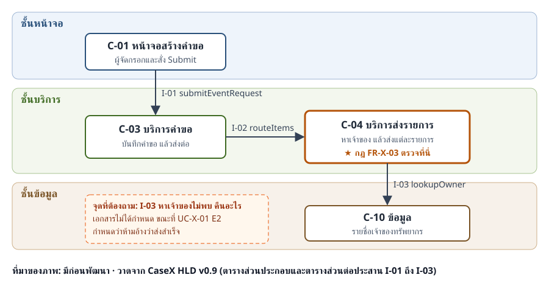

# ใบงานครั้งที่ 1 ส่วน B · วางแผนก่อนทดสอบ · Team00

> **ตัวอย่างของผู้สอน** · ทีมสมมติใช้ Case X แทนโครงงาน ENGSE212 · ใบงานจริงต้องใช้โครงงานของทีม · ห้ามคัดลอกข้อความ
> เนื้อหาตรงกับตัวอย่างเดินครบ 6 ขั้นในแนวทางการทำใบงานครั้งที่ 1 แต่จัดให้อยู่ในรูปใบงานที่กรอกครบ

| รายการ | ข้อมูล |
|---|---|
| ชื่อทีม | Team00 |
| ชื่อโครงงาน | Case X · Multi-Resource Event Booking (แทนโครงงาน ENGSE212) |
| เอกสารที่ใช้ | CaseX SRS v1.1 · CaseX HLD v0.9 |

## ขั้นที่ 1 feature และกฎที่สำคัญที่สุด (2 คะแนน)

| หัวข้อ | คำตอบของทีม |
|---|---|
| feature | ส่งคำขอกิจกรรม (UC-X-01) |
| กฎที่สำคัญที่สุด | แต่ละรายการทรัพยากรต้องถูกส่งถึงเจ้าของที่ถูกต้อง และถ้าหาเจ้าของไม่พบ ห้ามอ้างว่าส่งสำเร็จ |
| พบกฎนี้ที่ไหน | SRS v1.1 ข้อ FR-X-03 และ UC-X-01 เส้นทางข้อยกเว้น E2 |
| ทำไมเลือกข้อนี้ | ถ้าผิด เจ้าของไม่ได้รับคำขอ และผู้จัดไม่รู้ว่ารายการใดค้างอยู่ จนถึงวันจัดกิจกรรม |

## ขั้นที่ 2 ส่วนประกอบที่ feature นี้ผ่าน (2 คะแนน)

**ที่มาของภาพ: มีก่อนพัฒนา** จากเอกสาร CaseX HLD v0.9 ตารางส่วนประกอบและตารางส่วนต่อประสาน I-01 ถึง I-03

ภาพมีครบ 4 อย่าง: ชื่อส่วนประกอบ · ชั้นของแต่ละส่วน · ลูกศรทางเดินข้อมูล · ส่วนประกอบที่ตรวจกฎ (C-04)

## ขั้นที่ 3 สามคำถาม (6 คะแนน)

| คำถาม | คำตอบและเหตุผล |
|---|---|
| 1 ใครรับผิดชอบ | C-04 บริการส่งรายการ อยู่ในชั้นบริการ ถูกชั้นแล้ว เพราะทุกคำขอต้องผ่าน C-03 แล้วไป C-04 ไม่ว่าจะมาจากหน้าจอหรือเรียก API ตรง |
| 2 ข้อมูลส่งถึงครบไหม | ไม่ครบ · I-03 `lookupOwner` คืน `ownerId` เมื่อพบ แต่ไม่ได้กำหนดว่าถ้าไม่พบจะคืนอะไร และ I-02 `routeItems` คืนแค่จำนวนรายการที่ส่งสำเร็จ ไม่บอกว่ารายการไหนไม่สำเร็จ |
| 3 ถ้าพัง จะรู้ได้ไหม | ถ้าหาเจ้าของไม่พบ ผู้จัดจะไม่รู้ว่ารายการไหนค้าง เพราะ I-02 ไม่ส่งรายชื่อรายการที่ไม่สำเร็จกลับมา ต้องทดสอบระดับ Integration โดยเตรียมข้อมูลทรัพยากรที่ไม่มีเจ้าของ |

## ขั้นที่ 4 ข้อค้นพบ 1 ข้อ ครบ 4 ส่วน (4 คะแนน)

| ส่วน | ข้อความ |
|---|---|
| 1 เอกสารเขียนว่าอะไร อยู่ตรงไหน | CaseX HLD v0.9 ตารางส่วนต่อประสาน I-03 `lookupOwner` ข้อมูลออกมีแค่ `ownerId` ไม่ได้กำหนดสิ่งที่คืนกลับเมื่อหาเจ้าของไม่พบ |
| 2 ขัดกับข้อใด | SRS v1.1 UC-X-01 E2 กำหนดว่าเมื่อไม่พบเจ้าของ ระบบห้ามอ้างว่าส่งสำเร็จ ต้องสร้างประเด็นเปิดและแจ้งผู้จัด |
| 3 ผลต่อการทดสอบ | ทีมกำหนดผลที่คาดหวังของกรณีหาเจ้าของไม่พบไม่ได้ ทั้งระดับ Integration (C-04 กับ C-10) และระดับ System (ผู้จัดเห็นอะไร) |
| 4 ข้อเสนอ | ให้กำหนดค่าที่ I-03 คืนเมื่อไม่พบ และให้ I-02 คืนรายการที่ไม่สำเร็จ · ขอให้ผู้กำหนดนโยบายตอบ TBD-X-04 ว่าจะหยุดเฉพาะรายการนั้นหรือทั้งคำขอ |

ข้อเสนอไม่ได้เดาคำตอบของ TBD-X-04 เอง เพราะเป็นเรื่องที่ผู้มีอำนาจต้องตัดสิน

## ขั้นที่ 5 ขอบเขตและกลยุทธ์การทดสอบ (2 คะแนน)

| หัวข้อ | คำตอบของทีม |
|---|---|
| ทดสอบ | การส่งรายการถึงเจ้าของ · กรณีหาเจ้าของไม่พบ · ข้อมูลที่ส่งกลับให้ผู้จัด · การตรวจข้อมูลก่อนส่ง (จำนวนวัน จำนวนทรัพยากร ผู้รับผิดชอบอุปกรณ์) |
| ไม่ทดสอบ พร้อมเหตุผล | การแจ้งเตือนทางอีเมล (FR-X-06) เพราะยังไม่มีบริการอีเมลในเครื่องทดสอบ |
| ระดับที่จะทดสอบ | Unit การตรวจข้อมูลใน C-03 · Integration C-03 กับ C-04 และการเรียก API ตรง · System ผ่านหน้าจอส่งคำขอ · UAT กับผู้จัดกิจกรรมจริง |
| ลำดับความเสี่ยง 3 อันดับ | 1 หาเจ้าของไม่พบแต่ระบบบอกว่าส่งสำเร็จ · 2 ส่งผิดเจ้าของ · 3 ข้อความแจ้งผู้จัดไม่ชัด |

## ขั้นที่ 6 Entry 2 ข้อ และ Exit 2 ข้อ (3 คะแนน)

| Entry | Exit |
|---|---|
| 1. มีข้อมูลรายชื่อเจ้าของสำหรับทดสอบ ทั้งทรัพยากรที่มีเจ้าของและที่ไม่มีเจ้าของ | 1. รันกรณีทดสอบครบทั้งกรณีส่งสำเร็จ และกรณีหาเจ้าของไม่พบ |
| 2. C-03 และ C-04 ติดตั้งบนเครื่องทดสอบ และผ่าน Unit Test แล้ว | 2. ไม่มีข้อบกพร่องระดับสูงค้างอยู่ในการส่งรายการ |

ทุกข้อวัดได้ และเกี่ยวกับ feature ส่งคำขอ ไม่ใช่เกณฑ์ทั่วไป เช่น “ระบบพร้อม”

## ขั้นที่ 7 หน้าที่ของสมาชิกและการใช้ AI (1 คะแนน)

ช่องรหัสนักศึกษาในใบงาน **เว้นไว้** เมื่อวางใน repo เพราะ repo เป็น Public

| ชื่อ–สกุล | รหัส | ทำส่วนใด |
|---|---|---|
| สมาชิก ก (ชื่อสมมติ) | (เว้นไว้) | หากฎจาก SRS และ HLD · ตอบคำถามที่ 1 |
| สมาชิก ข (ชื่อสมมติ) | (เว้นไว้) | วาดภาพส่วนประกอบ · ตอบคำถามที่ 2 · เขียนข้อค้นพบ |
| สมาชิก ค (ชื่อสมมติ) | (เว้นไว้) | ตอบคำถามที่ 3 · เขียนขอบเขตและ Entry/Exit |
| ทุกคน | | ตรวจข้อค้นพบร่วมกัน |

| ใช้ AI หรือไม่ เพื่ออะไร | ข้อเสนอที่รับ แก้ หรือปฏิเสธ | ตรวจกับโค้ดหรือเอกสารใด |
|---|---|---|
| ใช้ Claude จัดเนื้อหาให้อยู่ในรูปใบงาน (ดู [AI-LOG.md](../AI-LOG.md)) | รับรูปแบบตาราง · ผู้สอนตรวจรหัสทุกตัวกับเอกสารก่อนใช้ · ไม่ให้ AI ตอบ TBD-X-04 แทนผู้กำหนดนโยบาย | CaseX HLD v0.9 ตาราง I-01 ถึง I-05 · SRS v1.1 UC-X-01 |
