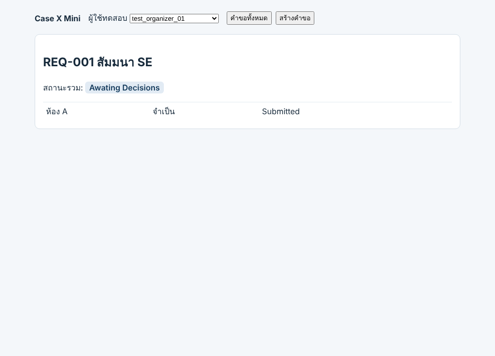

# ผลการรันจริง (B1) · ตัวอย่าง Team00

> **ตัวอย่างของผู้สอน** · รันจริงกับแอปสาธิต Case X Mini v0.9 · ผลรวมข้อที่ไม่ผ่านบันทึกตามที่เกิดขึ้น · ห้ามคัดลอกผลหรือภาพไปใช้กับงานของทีม

| รายการ | ข้อมูล |
|---|---|
| ทีม · feature | Team00 · ส่งคำขอกิจกรรม (UC-X-01) |
| รุ่นของระบบที่รัน | Case X Mini v0.9 · backend 0.9.0 · frontend 0.9.0 ([zip ที่แจกในครั้งที่ 3](https://se-rmutl.github.io/engse601/materials/app/CaseXMini_v0.9_Student_S3.zip)) |
| ชุดอ้างอิงที่ใช้ | รุ่น v1 · [02-test-design/S2-B_Team00.md](../02-test-design/S2-B_Team00.md) · ไม่ได้แก้ |
| เครื่องมือ | Node.js 22.22.0 · Jest 29.7.0 · Supertest 7.3.0 · Playwright 1.63.0 กับ Chromium |
| สภาพแวดล้อม | เครื่องทดสอบในเครื่อง (Linux x86_64) · Unit และ API ใช้ข้อมูลจาก `tests/fixtures` รีเซ็ตก่อนทุกกรณี · System เปิด backend โหมดทดสอบ `NODE_ENV=test` และหน้าจอที่ `localhost:5173` · บัญชีทดสอบ `u-org-01` (test_organizer_01) |
| วันที่รัน · ผู้รัน | 20 ต.ค. 2569 เวลา 22:30–22:31 น. · ผู้สอนร่วมกับ Claude (ทีมจริงใส่ชื่อสมาชิกที่รัน) |

## ตรวจ Entry ของทีมก่อนรัน (จากใบงานครั้งที่ 1)

| Entry | เป็นจริงไหม | ทีมทำอย่างไร |
|---|---|---|
| มีข้อมูลรายชื่อเจ้าของสำหรับทดสอบ ทั้งทรัพยากรที่มีเจ้าของและที่ไม่มีเจ้าของ | **ไม่ครบ** · ข้อมูลตั้งต้นของ v0.9 มีแต่ทรัพยากรที่มีเจ้าของ | กรณีหาเจ้าของไม่พบยังไม่อยู่ในชุด v1 อยู่แล้ว (รอ TBD-X-04 · OI-01) จึงรันส่วนที่เหลือได้ และบันทึกข้อนี้ไว้ |
| C-03 และ C-04 ติดตั้งบนเครื่องทดสอบ และผ่าน Unit Test แล้ว | ติดตั้งแล้ว · **Unit ไม่ผ่าน 1 ข้อ** (TC-02) | รันระดับ API ต่อเพื่อดูว่าปัญหาเดียวกันเห็นจากภายนอกหรือไม่ · บันทึกว่าเริ่ม Integration โดยที่ Entry ข้อนี้ยังไม่ครบ |

Entry ที่ไม่ครบไม่ได้ทำให้ต้องหยุด แต่ต้องเขียนให้เห็น ผู้อ่านจะรู้ว่าผลระดับ API อาจมีปัญหาที่มาจากระดับ Unit

## ขั้นที่ 1 เลือกระดับ (3 คะแนน)

เหตุผลบอกว่าพฤติกรรมที่ตรวจอยู่ที่ไหน

| TC | ระดับ | เหตุผล (พฤติกรรมอยู่ที่ไหน) |
|---|---|---|
| TC-01 | Unit และ Integration (API) | Unit: ตรรกะจำนวนวันอยู่ในฟังก์ชันเดียว `validateRequest` ของ C-03 · API: ต้องตรวจด้วยว่าเมื่อเรียกผ่าน HTTP ได้ 400 และไม่มีข้อมูลถูกบันทึก ซึ่งเกิดระหว่าง route บริการ และชั้นข้อมูล |
| TC-02 | Unit และ Integration (API) | เหมือน TC-01 · เป็นค่าขอบล่าง จึงรันทั้งสองระดับเพื่อดูว่าข้อผิดพลาดอยู่ชั้นใด |
| TC-03 | Unit | ตรรกะอยู่ในฟังก์ชันเดียว ไม่ต้องใช้ส่วนอื่น |
| TC-04 | Unit | ตรรกะอยู่ในฟังก์ชันเดียว |
| TC-05 | Unit | ตรรกะอยู่ในฟังก์ชันเดียว |
| TC-06 | Unit | การนับจำนวนทรัพยากรอยู่ในฟังก์ชันเดียว |
| TC-07 | Unit | ตรรกะอยู่ในฟังก์ชันเดียว |
| TC-08 | Unit | ตรรกะอยู่ในฟังก์ชันเดียว |
| TC-09 | Unit | ตรรกะอยู่ในฟังก์ชันเดียว |
| TC-10 | Unit | ตารางตัดสินใจของ FR-X-04 อยู่ในฟังก์ชันเดียว ใช้ข้อมูลทรัพยากรจาก fixture |
| TC-11 | Unit และ Integration (API) | Unit: ตรรกะในฟังก์ชันเดียว · API: ต้องตรวจว่าการเรียกตรงโดยไม่ผ่านหน้าจอก็ถูกปฏิเสธ |
| TC-12 | Unit | ตรรกะอยู่ในฟังก์ชันเดียว |
| TC-23 | Integration (API) | การตรวจการเข้าสู่ระบบอยู่ที่ middleware ก่อนถึงบริการ ต้องเรียกผ่าน HTTP จึงจะเห็น |
| SYS-01 | System | ต้องเห็นผลทั้งระบบผ่านหน้าจอ ตั้งแต่กรอกจนเห็นสถานะ (หน้าจอ + API + ข้อมูล) |

## ขั้นที่ 2 กรณีทดสอบอัตโนมัติ (6 คะแนน)

| รายการ | ข้อมูล |
|---|---|
| TC และระดับ | TC-02 · Unit และ API (รันทั้งไฟล์ จึงได้ผล TC-01 ถึง TC-12 ระดับ Unit และ TC-01 TC-02 TC-11 TC-23 ระดับ API ไปพร้อมกัน) |
| ไฟล์โค้ดทดสอบ | [tests/backend/tests/unit/requestService.test.js](tests/backend/tests/unit/requestService.test.js) · [tests/backend/tests/api/requests.api.test.js](tests/backend/tests/api/requests.api.test.js) |
| คำสั่งที่ใช้รัน | `npx jest --runInBand tests/unit/requestService.test.js` · `npx jest --runInBand tests/api/requests.api.test.js -t UC-X-01` (รันในโฟลเดอร์ `backend` ของแอป) |
| หลักฐาน | [evidence/TC-01_to_TC-12_unit_2026-10-20.txt](evidence/TC-01_to_TC-12_unit_2026-10-20.txt) · [evidence/TC-01_TC-02_TC-11_TC-23_api_2026-10-20.txt](evidence/TC-01_TC-02_TC-11_TC-23_api_2026-10-20.txt) |
| สถานะ | **Fail** เพราะขอล่วงหน้า 3 วันซึ่งเป็นค่าขอบล่างที่ต้องรับ ระบบกลับปฏิเสธ · Unit: Expected true · Received false · API: Expected 201 · Received 400 |

ผลเทอร์มินัล ระดับ Unit (คัดลอกจากไฟล์หลักฐานทั้งก้อน ไม่ตัดไม่แก้)

```text
FAIL tests/unit/requestService.test.js
  R-A ขอล่วงหน้าได้ 3 ถึง 30 วัน (กฎสมมติ)
    ✓ TC-01 ขอล่วงหน้า 2 วัน ควรผ่าน=false (เลยขอบล่าง) (21 ms)
    ✕ TC-02 ขอล่วงหน้า 3 วัน ควรผ่าน=true (ขอบล่าง) (2 ms)
    ✓ TC-03 ขอล่วงหน้า 15 วัน ควรผ่าน=true (ตัวแทนกลุ่มที่ถูกต้อง)
    ✓ TC-04 ขอล่วงหน้า 30 วัน ควรผ่าน=true (ขอบบน) (1 ms)
    ✓ TC-05 ขอล่วงหน้า 31 วัน ควรผ่าน=false (เลยขอบบน)
  R-B หนึ่งคำขอมีทรัพยากรได้ 1 ถึง 10 รายการ (กฎสมมติ)
    ✓ TC-06 มีทรัพยากร 0 รายการ ควรผ่าน=false (1 ms)
    ✓ TC-07 มีทรัพยากร 1 รายการ ควรผ่าน=true
    ✓ TC-08 มีทรัพยากร 10 รายการ ควรผ่าน=true (1 ms)
    ✓ TC-09 มีทรัพยากร 11 รายการ ควรผ่าน=false (1 ms)
  FR-X-04 อุปกรณ์ต้องมีผู้รับผิดชอบ (ตารางตัดสินใจ)
    ✓ TC-10 มีอุปกรณ์ และระบุผู้รับผิดชอบ -> ผ่าน (1 ms)
    ✓ TC-11 มีอุปกรณ์ แต่ไม่ระบุผู้รับผิดชอบ -> ไม่ผ่าน และบอกว่าขาดอะไร
    ✓ TC-12 ไม่มีอุปกรณ์เลย -> ผ่าน

  ● R-A ขอล่วงหน้าได้ 3 ถึง 30 วัน (กฎสมมติ) › TC-02 ขอล่วงหน้า 3 วัน ควรผ่าน=true (ขอบล่าง)

    expect(received).toBe(expected) // Object.is equality

    Expected: true
    Received: false

      20 |     const result = validateRequest(input, resources);
      21 |     // Assert
    > 22 |     expect(result.ok).toBe(expected);
         |                       ^
      23 |   });
      24 | });
      25 |

      at toBe (tests/unit/requestService.test.js:22:23)

Test Suites: 1 failed, 1 total
Tests:       1 failed, 11 passed, 12 total
Snapshots:   0 total
Time:        0.7 s
Ran all test suites matching /tests\/unit\/requestService.test.js/i.
```

## ขั้นที่ 3 System ทำมือ (4 คะแนน)

| รายการ | ข้อมูล |
|---|---|
| TC | SYS-01 · REQ-05 |
| ขั้นตอน | 1. เปิด `http://localhost:5173` ผู้ใช้ทดสอบเป็น test_organizer_01 <br> 2. กด **สร้างคำขอ** <br> 3. กรอกชื่อกิจกรรม `สัมมนา SE` ขอใช้ล่วงหน้า `5` วัน ทรัพยากร ห้อง A ติ๊ก “จำเป็น” <br> 4. กด **ส่งคำขอ** แล้วอ่านสถานะรวม |
| ผลที่คาดหวัง | เห็นสถานะรวม Awaiting Decisions (จากชุดอ้างอิง v1) |
| ผลจริง | บันทึกคำขอ REQ-001 ได้ แต่ป้ายสถานะแสดง **Awating Decisions** สะกดผิด · ภาพ: [ขั้น 1](evidence/SYS-01_system_2026-10-20_1-home.png) · [ขั้น 3](evidence/SYS-01_system_2026-10-20_2-form.png) · [ผลหลังกดส่ง](evidence/SYS-01_system_2026-10-20_3-result.png) |
| สถานะ | **Fail** · ข้อความที่ผู้ใช้เห็นไม่ตรงกับเกณฑ์การยอมรับ AC-X-02 |



ในตัวอย่างนี้ ผู้จัดทำกดตามขั้นตอนผ่าน Chromium ด้วยสคริปต์ เพื่อถ่ายภาพหน้าจอทีละขั้น ทีมทำด้วยมือแล้วถ่ายภาพหน้าจอเองได้ · รัน SYS-01 แบบอัตโนมัติด้วย Playwright ซ้ำอีกครั้ง ได้ผลเดียวกัน: [evidence/SYS-01_system-auto_2026-10-20.txt](evidence/SYS-01_system-auto_2026-10-20.txt) (Expected "Awaiting Decisions" · Received "Awating Decisions")

## ขั้นที่ 4 UAT (3 คะแนน)

ผู้ทดสอบ UAT คือผู้ใช้จริงหรือตัวแทนผู้ใช้ ไม่ใช่สมาชิกทีม

| รายการ | ข้อมูล |
|---|---|
| ชื่อสถานการณ์ · ผู้ทดสอบ | จองห้องและโปรเจกเตอร์สำหรับสัมมนาสัปดาห์หน้า · ผู้จัดกิจกรรมจริงของภาควิชา 1 คน |
| ขั้นตอน (ลำดับงานของผู้ใช้) | 1. สร้างคำขอสัมมนาของสัปดาห์หน้าด้วยข้อมูลงานจริงของตน <br> 2. เพิ่มห้องและโปรเจกเตอร์ แล้วระบุผู้รับผิดชอบโปรเจกเตอร์ <br> 3. ส่งคำขอ <br> 4. อ่านหน้าคำขอแล้วบอกว่าต้องรอใครตัดสินรายการใด |
| ถือว่าผ่านเมื่อ | ผู้จัดทำเสร็จเองโดยไม่ต้องถามทีม และบอกได้ถูกว่ากิจกรรมพร้อมจัดหรือยัง ต้องรออะไร |
| สถานะ และแผน | **Not Executed** · ยังไม่มีผู้ใช้จริงร่วมทดสอบ และรุ่น v0.9 ยังมีข้อที่ไม่ผ่าน 2 ข้อ · แผน: ทดสอบกับผู้จัดกิจกรรมของภาควิชา 1 คน หลังแก้ TC-02 และ SYS-01 ในรุ่น v1.0 ผู้ประสานคือสมาชิก ค |

## ขั้นที่ 5 ตารางผลของทุกกรณีทดสอบ (3 คะแนน)

| TC | ระดับ | ผลที่คาดหวัง | ผลจริง | สถานะ | หลักฐาน |
|---|---|---|---|---|---|
| TC-01 | Unit · API | ไม่ให้ส่ง 2 วัน · API 400 ไม่บันทึก | ปฏิเสธ · 400 ไม่บันทึก | Pass | [unit](evidence/TC-01_to_TC-12_unit_2026-10-20.txt) · [api](evidence/TC-01_TC-02_TC-11_TC-23_api_2026-10-20.txt) |
| TC-02 | Unit · API | รับ 3 วัน · API 201 บันทึก 1 รายการ | ปฏิเสธ (Expected true · Received false) · 400 | **Fail** | [unit](evidence/TC-01_to_TC-12_unit_2026-10-20.txt) · [api](evidence/TC-01_TC-02_TC-11_TC-23_api_2026-10-20.txt) |
| TC-03 | Unit | รับ 15 วัน | รับ | Pass | [unit](evidence/TC-01_to_TC-12_unit_2026-10-20.txt) |
| TC-04 | Unit | รับ 30 วัน | รับ | Pass | [unit](evidence/TC-01_to_TC-12_unit_2026-10-20.txt) |
| TC-05 | Unit | ไม่ให้ส่ง 31 วัน | ปฏิเสธ | Pass | [unit](evidence/TC-01_to_TC-12_unit_2026-10-20.txt) |
| TC-06 | Unit | ไม่ให้ส่ง 0 รายการ | ปฏิเสธ | Pass | [unit](evidence/TC-01_to_TC-12_unit_2026-10-20.txt) |
| TC-07 | Unit | รับ 1 รายการ | รับ | Pass | [unit](evidence/TC-01_to_TC-12_unit_2026-10-20.txt) |
| TC-08 | Unit | รับ 10 รายการ | รับ | Pass | [unit](evidence/TC-01_to_TC-12_unit_2026-10-20.txt) |
| TC-09 | Unit | ไม่ให้ส่ง 11 รายการ | ปฏิเสธ | Pass | [unit](evidence/TC-01_to_TC-12_unit_2026-10-20.txt) |
| TC-10 | Unit | รับ เมื่ออุปกรณ์มีผู้รับผิดชอบ | รับ | Pass | [unit](evidence/TC-01_to_TC-12_unit_2026-10-20.txt) |
| TC-11 | Unit · API | ไม่ให้ส่ง ชี้อุปกรณ์ที่ขาด · API 400 | ปฏิเสธ บอกสิ่งที่ขาด · 400 | Pass | [unit](evidence/TC-01_to_TC-12_unit_2026-10-20.txt) · [api](evidence/TC-01_TC-02_TC-11_TC-23_api_2026-10-20.txt) |
| TC-12 | Unit | รับ เมื่อไม่มีอุปกรณ์ | รับ | Pass | [unit](evidence/TC-01_to_TC-12_unit_2026-10-20.txt) |
| TC-23 | API | ไม่รับ 401 | 401 | Pass | [api](evidence/TC-01_TC-02_TC-11_TC-23_api_2026-10-20.txt) |
| SYS-01 | System | เห็น Awaiting Decisions | เห็น Awating Decisions | **Fail** | [ภาพ](evidence/SYS-01_system_2026-10-20_3-result.png) · [auto](evidence/SYS-01_system-auto_2026-10-20.txt) |

สรุป: Pass 12 · Fail 2 · Blocked 0 · Not Executed 0 · (UAT 1 สถานการณ์ Not Executed พร้อมแผน)

ทีมไม่ได้แก้ผลที่คาดหวังของ TC-02 และ SYS-01 ให้ตรงกับผลจริง · ไม่ต้องทำ B2 (รายงานข้อบกพร่องและคำตัดสิน) เพราะไม่ได้สอนครั้งที่ 4

## ไม่อยู่ในชุดนี้

| เรื่อง | เหตุผล |
|---|---|
| FR-X-03 กรณีหาเจ้าของไม่พบ | ผลที่คาดหวังขึ้นกับ TBD-X-04 ยังไม่มีคำตอบ · ประเด็นเปิด OI-01 |
| FR-X-06 แจ้งเตือนทางอีเมล | อยู่นอกขอบเขตตั้งแต่ใบงานครั้งที่ 1 เพราะไม่มีบริการอีเมลในเครื่องทดสอบ |
